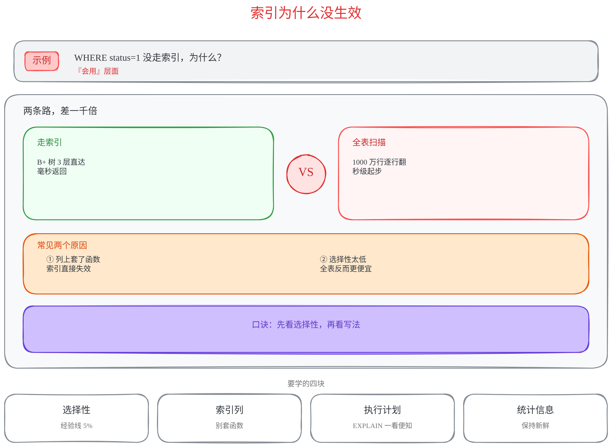
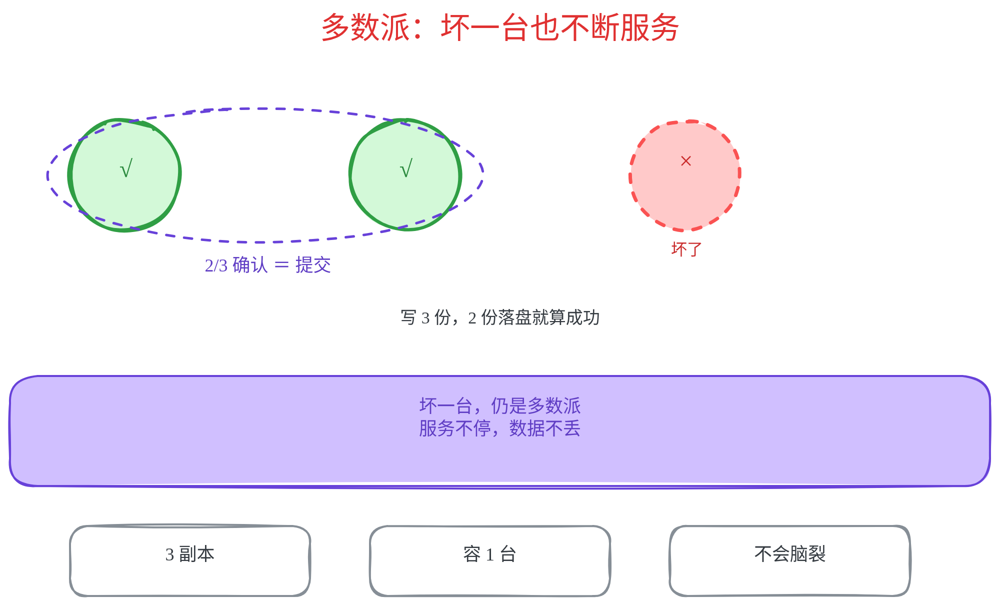

# cute-draw

**Excalidraw 手绘风讲解图 Skill** —— 一张图讲清一个概念，读者 30 秒看懂。宁可图多，字少。

适用于 AI 编码助手（ZCode / Claude Code 等）的画图任务：生成教学讲解图、概念示意图、『问 N』系列配图。不适用于正式工程图（UML / ERD / 架构拓扑）。

## 样例

**完整骨架**（问题卡 + 左右对决场景 + 原因条 + 本质条 + 四知识卡）：



**极简骨架**（标题 + 一组主体图 + 本质条 + 要点卡）：



> 样例源文件在 `samples/*.excalidraw`，可直接拖进 [excalidraw.com](https://excalidraw.com) 编辑。

## 三条硬约束

1. **字号比直觉大一档** —— 主标题 28-32px、区块标题 17-18px、正文 15-16px、最小注释不低于 13px。手写体小字号会糊，宁大勿小。
2. **言简意赅** —— 每个文本块最多 2 行、每行不超过 14 字；短语优先于句子；写完把全图字数砍一半。讲解细节放对话回复，不放图里。
3. **图间零依赖** —— 每张图自含自明，图内禁止引用其他图（『问 39』『见前图』）。读者只看这一张也要能懂。

## 配色语义

读者靠颜色读图，全系列保持一致：

| 颜色 | 色值 | 语义 |
|---|---|---|
| 红 | `#fa5252` / `#c92a2a` | 坏、威胁、反例、事故 |
| 绿 | `#2f9e44` / `#2b8a3e` | 好、守护、正确写法 |
| 蓝 | `#1971c2` / `#1864ab` | 结构、流程、中性机制 |
| 紫 | `#6741d9` / `#5f3dc4` | 映射、概念、本质横幅 |
| 橙 | `#e8590c` / `#d9480f` | 权衡、代价、警告 |
| 灰 | `#868e96` | 次要、失活、慢节点 |

## 仓库结构

```
cute-draw/
├── SKILL.md                        # 技能入口：骨架坐标、硬约束、汇报格式
├── references/
│   └── excalidraw-json.md          # JSON 字段模板 + 踩坑表 + 校验脚本
├── samples/
│   ├── index-sample.excalidraw     # 样例：完整骨架
│   ├── index-sample.png
│   ├── quorum-sample.excalidraw    # 样例：极简骨架
│   └── quorum-sample.png
└── agents/openai.yaml              # UI 元数据
```

## 安装

```bash
# ZCode
git clone https://github.com/ApolloMonasa/cute-draw.git ~/.zcode/skills/cute-draw

# Claude Code
git clone https://github.com/ApolloMonasa/cute-draw.git ~/.claude/skills/cute-draw
```

装好后对助手说“用 cute-draw 画一张 XX 讲解图”即可。生成流程与校验脚本见 `SKILL.md` 与 `references/excalidraw-json.md`——手写 JSON 写完必须跑校验，不过不交付。
